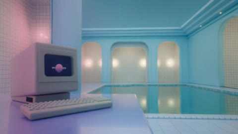
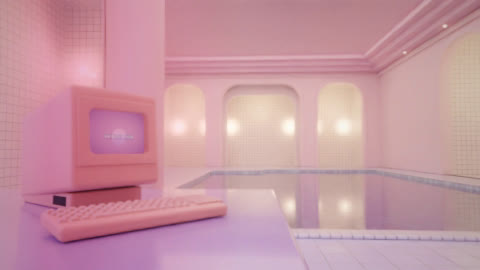
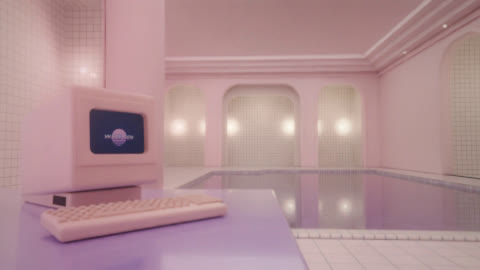

# Preset catalog

Every preset in the library, what it builds on and what it changes.
Generated by `python -m wavegen presets catalog`; edit the presets, not this page.

## Family tree

```
poolrooms
├── lavender_hall
├── poolrooms_dusk
├── poolrooms_night
└── rose_natatorium
```

## lavender_hall


Lavender hall: a tall violet room with one very wide back arch, matched to the WAVE GEN emblem's purples.

- Builds on `poolrooms` (lineage: lavender_hall -> poolrooms)
- Tags: purple, day, tall
- Changes: palette (9), room (3), post (1)

## poolrooms



Faithful parallel of the reference clip: a cyan tiled poolroom with warm lit alcoves, a stepped tray ceiling and a beige CRT on a lavender desk. The base most designs build on.

- A root design: every value is its own
- Tags: reference, day, cyan

## poolrooms_dusk



The same room at golden hour: peach plaster, rose water, stronger warm alcoves and a slower, sweeter pad.

- Builds on `poolrooms` (lineage: poolrooms_dusk -> poolrooms)
- Tags: mood, dusk, warm, pink
- Changes: palette (11), lights (2), render (1), audio (2)

## poolrooms_night


After hours: the cove dimmed, a deep blue room lit by the alcove lamps, a magenta neon accent and the CRT glow.

- Builds on `poolrooms` (lineage: poolrooms_night -> poolrooms)
- Tags: mood, night, blue, neon
- Changes: palette (10), lights (4), atmosphere (2), computer (1), render (4), audio (4), post (2), pool (2)

## rose_natatorium



Rose natatorium: blush plaster, cream tile, peach lamps and lilac water; the pink end of the reference's palette taken room-wide.

- Builds on `poolrooms` (lineage: rose_natatorium -> poolrooms)
- Tags: pink, day, warm
- Changes: palette (10), post (1)
