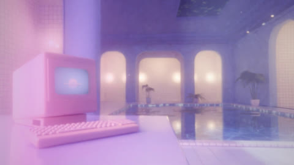

# Preset catalog

Every preset in the library, what it builds on and what it changes.
Generated by `python -m wavegen presets catalog`; edit the presets, not this page.

## Family tree

```
poolrooms
├── catenary_nave
├── lavender_hall
├── palm_solarium
├── poolrooms_dusk
│   └── lotus_court
├── poolrooms_night
│   └── moonlit_conservatory
└── rose_natatorium
```

## catenary_nave


Catenary nave: Gaudi's poolroom. Hanging-chain arches, tree columns branching into the ceiling, a honeycomb floor, warm sandstone and teal tile, sun dappling through the canopy.

- Builds on `poolrooms` (lineage: catenary_nave -> poolrooms)
- Tags: nature, biomimicry, day, warm, teal
- Changes: palette (14), room (4), nature (4), post (1)

## lavender_hall


Lavender hall: a tall violet room with one very wide back arch, matched to the WAVE GEN emblem's purples.

- Builds on `poolrooms` (lineage: lavender_hall -> poolrooms)
- Tags: purple, day, tall
- Changes: palette (9), room (3), post (1)

## lotus_court


Lotus court: the dusk room as a water garden. Lily pads drift in clusters with pink blooms, ferns soften the edges, the floor is laid in honeycomb.

- Builds on `poolrooms_dusk` (lineage: lotus_court -> poolrooms_dusk -> poolrooms)
- Tags: nature, dusk, pink, water-garden
- Changes: palette (2), room (1), nature (7)

## moonlit_conservatory



Moonlit conservatory: the night room under an open canopy. Pale moonlight falls through the leaves from beyond the far wall, palms stand in the dark, a few lilies glow on the water.

- Builds on `poolrooms_night` (lineage: moonlit_conservatory -> poolrooms_night -> poolrooms)
- Tags: nature, night, blue, moon
- Changes: palette (1), nature (7), atmosphere (1)

## palm_solarium


Palm solarium: a sunlit greenhouse pool. Dappled sun through a leafy skylight, potted palms and ferns, water lilies, warm ivory plaster and sea-green tile.

- Builds on `poolrooms` (lineage: palm_solarium -> poolrooms)
- Tags: nature, day, green, sun
- Changes: palette (9), nature (7), atmosphere (1), post (1)

## poolrooms


Faithful parallel of the reference clip: a cyan tiled poolroom with warm lit alcoves, a stepped tray ceiling and a beige CRT on a lavender desk. The base most designs build on.

- A root design: every value is its own
- Tags: reference, day, cyan

## poolrooms_dusk


The same room at golden hour: peach plaster, rose water, stronger warm alcoves and a slower, sweeter pad.

- Builds on `poolrooms` (lineage: poolrooms_dusk -> poolrooms)
- Tags: mood, dusk, warm, pink
- Changes: palette (11), lights (2), render (1), audio (2)

## poolrooms_night


After hours: the cove dimmed, a deep blue room lit by the alcove lamps, a magenta neon accent and the CRT glow.

- Builds on `poolrooms` (lineage: poolrooms_night -> poolrooms)
- Tags: mood, night, blue, neon
- Changes: palette (10), lights (4), atmosphere (2), computer (1), render (4), audio (4), post (2), pool (2)

## rose_natatorium


Rose natatorium: blush plaster, cream tile, peach lamps and lilac water; the pink end of the reference's palette taken room-wide.

- Builds on `poolrooms` (lineage: rose_natatorium -> poolrooms)
- Tags: pink, day, warm
- Changes: palette (10), post (1)
